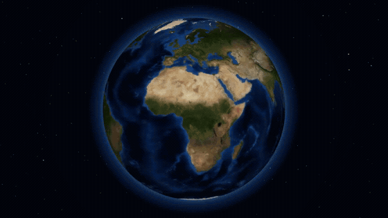
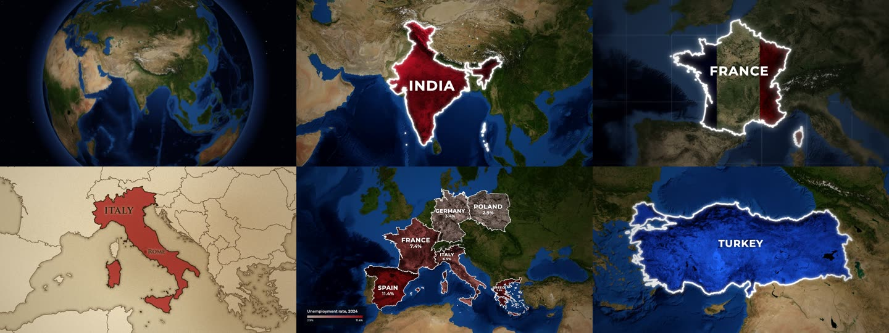

# mapcast

**Animated map videos for explainers, documentaries and Shorts, from one line of JSON.**
Highlight any country, state or province on real satellite imagery or an old paper map: tracing borders,
flags, glow, labels, capitals, data colours, a 3D globe dive and camera flights between countries.
Free, open source, and built for AI agents to drive.

[](https://www.npmjs.com/package/mapcast)
[](LICENSE)



<sub>Full-quality version: [docs/showcase.mp4](docs/showcase.mp4)</sub>

```bash
npx mapcast quick India -o india.mp4
```

That is the whole setup. The first run downloads Chromium and map data once (both cached); videos also need
[ffmpeg](https://ffmpeg.org/download.html).

## Ask your AI for it

mapcast is made to be driven by AI tools: you describe the map, the agent writes the scene, mapcast renders it.

> "Make a YouTube Short that spins the globe and lands on Brazil with its flag."
> "Old parchment map of Turkey, zooming in, with Istanbul marked."
> "Colour these countries by unemployment: Spain 11.4, Greece 9.8, Germany 3.4."

**Claude Code** (skill and MCP server in one install):

```
/plugin marketplace add 21prnv/mapcast
/plugin install mapcast@mapcast
```

**Claude Desktop, Cursor, Windsurf, Codex or any MCP client:** add this to the client's MCP config.

```json
{
  "mcpServers": {
    "mapcast": { "command": "npx", "args": ["-y", "mapcast", "mcp"] }
  }
}
```

The server offers `render_map` (saves the video or image and returns a preview of the final frame, so the agent
can check its work) and `preview_map` (one frame, to check a scene before rendering). Every option is described
in the tool schema.

**Agents that read `SKILL.md` skills:** `npx skills add 21prnv/mapcast`. The skill is in
[`skills/mapcast`](skills/mapcast), with [27 worked request-to-scene examples](skills/mapcast/references/examples.md).

## What it can do



- **Styles:** colour tint that keeps the terrain visible, spotlight (rest of the world turns grey), outline, or the
  country's flag laid over its land.
- **Basemaps:** NASA Blue Marble and Sentinel-2 satellite imagery, or an old parchment map with engraved coasts.
- **Cameras:** slow push-in, zoom in from a wide view, dive from a spinning 3D globe, fly from country to country.
- **Places:** every country by name or ISO code, plus 4,500 states and provinces (`"California"`, `"IN-MH"`), with
  capitals or any city marked.
- **Data maps:** colour countries by a number with a legend, with names and values on the map.
- **Formats:** MP4, GIF, PNG, JPG in 16:9, 9:16, 1:1 or 4:5.
- **Disputed borders:** drawn the way the highlighted country officially draws them, or a neutral view on request.

## Command line

```bash
npx mapcast quick "United States" --style highlight --color yellow -o usa.png
npx mapcast quick France --style flag -o france.mp4
npx mapcast quick Brazil --camera globe -o brazil.mp4          # dive in from a spinning Earth
npx mapcast quick India France Japan --camera fly -o tour.mp4   # fly from country to country
npx mapcast quick Italy --basemap paper -o italy.mp4

npx mapcast render scene.json -o out.mp4        # any scene; .mp4, .gif, .png or .jpg
npx mapcast render scene.json -o out.png --at 1.2
cat scene.json | npx mapcast render - -o out.gif
npx mapcast schema                              # the scene format as JSON Schema
npx mapcast mcp                                 # MCP server on stdio
```

Every file in [`examples/`](examples) renders as-is.

## Scene format

```json
{
  "aspect": "16:9",
  "duration": 5,
  "camera": "push-in",
  "highlights": [
    { "country": "India", "style": "solid", "color": "#c8102e", "label": "INDIA" }
  ]
}
```

| Field | Values | Default |
|---|---|---|
| `aspect` | `16:9`, `9:16`, `1:1`, `4:5` (or set `width`/`height`) | `16:9` |
| `duration` | seconds | `5` (`7` for `globe`, `1 + 3` per country for `fly`) |
| `fps` | frames per second | `30` |
| `camera` | `push-in`, `zoom-in`, `globe` (3D Earth dive), `fly` (country to country), `static`, or `{ "move", "fill", "from" }` | `push-in` |
| `basemap` | `satellite`, `bluemarble`, `sentinel`, `paper` (old parchment map) | `satellite` |
| `pov` | `auto` (the country's own official borders), `default`, or a code like `ind`, `chn`, `pak` | `auto` |
| `effects.grade` | `natural`, `muted`, `mono` | `natural` |
| `effects.vignette` | 0 to 1 | `0.45` |
| `effects.blur` | 0 to 1: soft-focus edges, like a camera lens | `0` |
| `effects.grid` | `true` or `{ "step", "color", "opacity" }`: lat/long grid over the sea only | off |
| `effects.borders` | `true`: thin borders of neighbouring countries | on for `paper` and states |
| `labelAnim` | default label animation for every highlight | `rise` |

Each highlight:

| Field | Values | Default |
|---|---|---|
| `country` | name (`"India"`) or ISO code (`"IN"`, `"IND"`) | `country` or `region` required |
| `region` | a state or province: `"California"`, `"Bavaria"`, `"US-CA"`, `"IN-MH"` | |
| `style` | `solid` (tinted fill), `highlight` (rest of the world goes grey), `outline`, `flag` (the country's flag over the terrain) | `solid` |
| `color` | any CSS colour or `red`, `yellow`, `blue`, ... | a distinct colour per country |
| `label` | text, or `false` for none | the country name |
| `border` | `{ "color", "width", "glow" }` or `false` | white, glowing |
| `labelAnim` | `rise`, `type` (typewriter), `spread` (letters close in), `slide`, `pop` | `rise` |
| `labelSize` | multiplier on the automatic label size, e.g. `0.7` or `1.3` | `1` |
| `labelFont` | `sans`, `serif`, or any font name | `sans` (`serif` on paper) |
| `capital` | `true` for the capital (a state's own capital for `region`), or a city name like `"Mumbai"` | off |
| `start` | seconds when this country starts animating | staggered automatically |

## Data maps

Colour countries by a number, with a legend:

```json
{
  "data": {
    "title": "GDP 2024 (trillion US$)",
    "prefix": "$",
    "unit": "T",
    "scheme": "heat",
    "values": { "India": 3.9, "China": 18.7, "Japan": 4.1 }
  }
}
```

`scheme` is one of `reds`, `blues`, `greens`, `heat`, `purples`, `diverging`, or a list of colours.
Set `"labels"` to `"name"`, `"value"` (the number with `prefix`/`unit`) or `"both"` to label each country,
and `min`/`max` to fix the colour range. A highlight's `label` can have a second line: `"INDIA\n1.4 BILLION"`.

## How it works

A scene is resolved against [Natural Earth](https://www.naturalearthdata.com) borders, the imagery tiles the camera
path needs are fetched and cached, and a headless Chromium draws each frame on a canvas (WebGL for the globe).
Frames are piped to ffmpeg. A 5 second 1080p clip takes about 15 seconds on a laptop.

## Credits and licence

MIT. Map data, imagery and font licences are in [NOTICE.md](NOTICE.md). Satellite imagery needs a credit line
wherever you publish; mapcast prints the exact line after every render.

Contributions are welcome: see [CONTRIBUTING.md](CONTRIBUTING.md).
